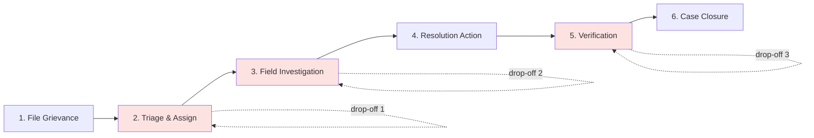

# Citizen/Field-Worker Journey Map

Six-stage journey from a citizen filing a grievance to it being closed, with
the field worker's side of each stage, and three points where cases are
observed to stall.

## Stage-by-stage

| # | Stage | Citizen side | Field-worker side |
|---|---|---|---|
| 1 | File Grievance | Submits issue via app/portal with category, location, photo | — |
| 2 | Triage & Assign | Waits for acknowledgment | Reviews, categorizes, routes to the right department/officer |
| 3 | Field Investigation | Can be contacted for clarification | Visits site, confirms issue, logs findings |
| 4 | Resolution Action | — | Carries out the fix / escalates if outside their authority |
| 5 | Verification | Confirms the issue is actually resolved | Field worker or citizen marks resolution complete |
| 6 | Case Closure | Receives closure notice, can leave feedback | Case archived with resolution notes |

## The 3 drop-off points

1. **Triage & Assign (Stage 2)** — cases sit unassigned because there's no
   default owner or SLA clock; nothing visibly "breaks," so nobody is
   prompted to act.
2. **Field Investigation (Stage 3)** — once assigned, a case can go quiet
   while it's genuinely in the field worker's queue, but there's no visible
   status for the citizen and no escalation trigger for stalled
   investigations.
3. **Verification (Stage 5)** — the field worker marks something "resolved"
   but closure isn't confirmed by the citizen, so cases can sit
   un-closed indefinitely even after the fix happened.

These three map directly onto the MVP's three acceptance-criteria pillars:
case ownership (fixes #1), status visibility (fixes #2), and
inactivity-triggered escalation (fixes #2 and #3).
